<div align="center">


# FlexPlay

**英語の動画を見ながら、分からない語句をその場で調べて覚える。**<br>
スマホ（Android）の動画アプリと、PCのChromeで見るYouTube・Netflix・Prime Videoに英語字幕を出し、<br>
単語をタップすると、その場面での意味を解説します。単語帳はスマホとPCで共有できます。

[**最新版をダウンロード**](https://github.com/kaish-yo/flexplay-releases/releases/latest) ・ [入れ方](#入れ方) ・ [使い方](#使い方スマホ) ・ [困ったとき](#困ったとき) ・ [プライバシーポリシー](https://kaish-yo.github.io/flexplay-site/privacy.html)

<table><tr>
<td width="29%">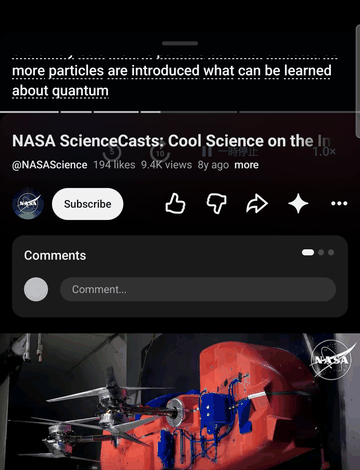</td>
<td width="71%"></td>
</tr><tr><td align="center">スマホ</td><td align="center">PC（Chrome）</td></tr></table>

</div>

---

## FlexPlayでできること

| | スマホ（Android） | PC（Chrome） |
| --- | --- | --- |
| 字幕を出す | 動画アプリの上に、再生中の英語をリアルタイムに字幕にして表示 | 作品の英語字幕を動画の上と一覧に表示。日本語訳も並べられる |
| 語句を調べる | 単語を長押しで語句の意味と使い方、文をタップで文全体の意味と構文 | 単語をクリックで語句の意味と使い方 |
| 繰り返し聞く | 5秒戻す・10秒進む・再生／一時停止 | 前・繰り返し・次の字幕へ移動、字幕ごとに自動で一時停止 |
| 覚える | 単語帳、ホーム画面のウィジェットで復習 | 単語帳、サイドパネルの復習カード |

Googleでサインインすると、**スマホとPCで同じ単語帳**を使えます。PCで登録した語がスマホのウィジェットに出てきます。

<p align="center">
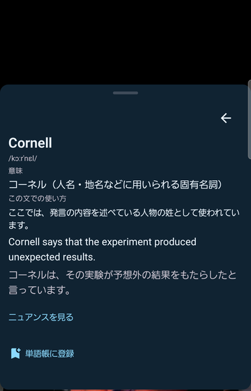

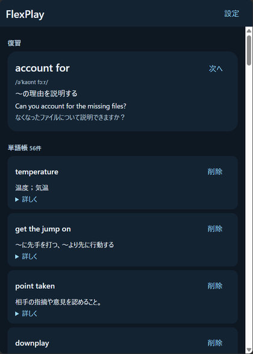
</p>

## 使えるかどうかの確認

### 対応環境

- **スマホ**：Android 15以上（Galaxy S26で確認しています）
- **PC**：Chrome 116以上（Windows・Mac）

### 対応サービス

**スマホ**

| アプリ | 字幕の作り方 |
| --- | --- |
| YouTube | 再生中の音声を端末内で音声認識 |
| Prime Video | 再生中の音声を端末内で音声認識（設定で「画面の英語字幕を読み取る」に切り替え可） |
| Netflix | 画面に出ている英語字幕を端末内で読み取る（Netflix側で英語字幕をオンにする） |
| Hulu | 再生中の音声を端末内で音声認識 |

音声認識は、Androidの英語の音声認識（端末内）を使います。初回は英語のモデルのダウンロードを求められることがあります。認識の精度は音声によって変わり、作品の正式な字幕と同じではありません。動画アプリ側が音声の取得を禁じている場合は字幕を作れません。

**PC**：YouTube・Netflix・Prime Video（primevideo.com と amazon.co.jp のPrime Video）。各サイトが配信している英語字幕を使うので、**英語字幕のない作品では使えません**（YouTubeは自動生成の英語字幕でも使えます）。

### 必要なもの

- **語句解説用のAPIキー**（自分のもの）：[OpenAIのAPIキー](https://platform.openai.com/api-keys)、またはOpenAI互換のAPI。
- **費用**：語句や文を調べた時だけ、そのAPIの利用料金がかかります。字幕を出すだけなら費用はかかりません（スマホの字幕は端末内で作り、PCはサイトの字幕を使うため）。
- **単語帳の同期**（任意）：Googleアカウント。

## ダウンロード

[**最新版のリリースページ**](https://github.com/kaish-yo/flexplay-releases/releases/latest)の「Assets」から、使う方を選んでください。

| ファイル | 用途 |
| --- | --- |
| `flexplay-<版>-android.apk` | スマホ（Android）用のアプリ |
| `flexplay-<版>-chrome.zip` | PCのChrome用の拡張機能 |
| `SHA256SUMS.txt` | ダウンロードしたファイルが正しいかの確認用（[確認方法](#ダウンロードしたファイルの確認)） |

その版で何が変わったかは、リリースページの「変更点」に書いています。

<p align="center">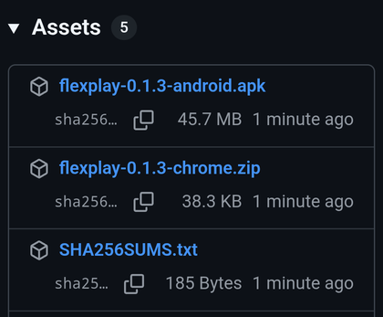</p>

## 入れ方

### スマホ（Android）

1. スマホのブラウザで最新版のページを開き、`flexplay-<版>-android.apk` をダウンロードして開きます。
2. 「この提供元からの不明なアプリをインストールすることはできません」と出たら「設定」を押し、**この提供元のアプリを許可**をオンにして戻ります。続けて「インストール」を押します（Google Play プロテクトの確認が出たら、内容を確かめてから進めてください）。

   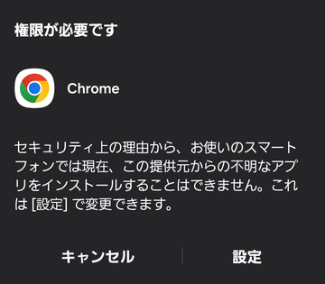

3. FlexPlayを開き、使いたい動画アプリを選んで「ライブ字幕を開始」を押すと、必要な許可を順に求められます。

| 許可 | 何のために使うか |
| --- | --- |
| 使用状況へのアクセス | 動画アプリが前面にある時だけ字幕を出すため。閲覧の履歴は保存しません |
| 音声の録音 | 再生中の動画の音声を端末内で認識するため（マイクの音は使いません） |
| 他のアプリの上に表示 | 動画の上に字幕を出すため |
| 通知へのアクセス（FlexPlay 再生制御） | 字幕から再生・一時停止・巻き戻しを操作するため |
| 通知の送信 | 字幕を作っている間の通知（ここから止められます） |
| 画面の共有（「画面全体を共有」を選ぶ） | Androidで再生中の音声を受け取るための仕組み。画面や音声は保存も送信もしません |
| ユーザー補助（FlexPlay 再生・字幕サポート） | Prime Video・Netflixの再生位置の操作と、Netflixの字幕の読み取り。使う場合だけ |

<p align="center">
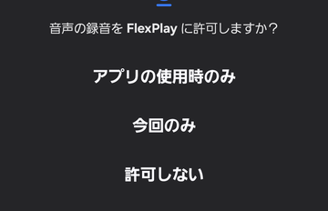
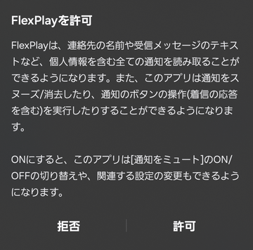
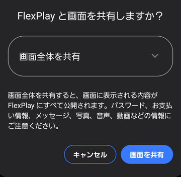
</p>

### PC（Chrome）

1. `flexplay-<版>-chrome.zip` をダウンロードし、**決まった場所に展開**します（例：`ドキュメント\FlexPlay`）。Chromeはこのフォルダから読み込み続けるので、**フォルダを消したり動かしたりすると動かなくなります**。
2. Chromeのアドレス欄に `chrome://extensions` と入れて開き、右上の**デベロッパー モード**をオンにします。
3. **パッケージ化されていない拡張機能を読み込む**を押し、展開したフォルダ（`manifest.json` が入っているフォルダ）を選びます。

   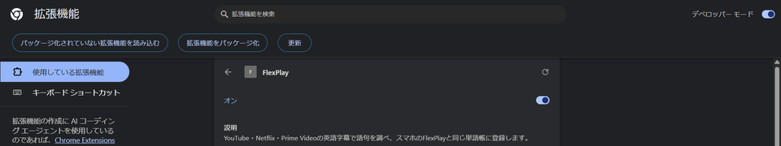

4. ツールバーのパズルのアイコンからFlexPlayの**ピン**を押して、ツールバーに固定します。

FlexPlayはChrome ウェブストアを通さずに配っているため、Chromeが「デベロッパー モードの拡張機能」について注意を出すことがあります。このページから入れたFlexPlayであれば、そのまま使い続けて問題ありません。見覚えのない拡張機能がある時は無効にしてください。

## 最初の設定

### APIキーを保存する

- **スマホ**：FlexPlay →「設定」→「API設定」でAPIキーを入れ、「保存して接続確認」を押します。送信先（Base URL）と解説モデルは、OpenAIを使うなら変えなくて構いません。
- **PC**：ツールバーのFlexPlay → サイドパネルの「設定」→「語句解説のAPI」でAPIキーを入れ、「接続を確認して保存」を押します。

<p align="center">
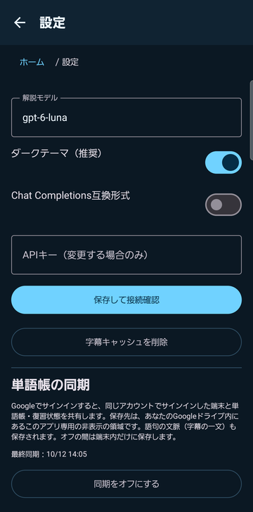
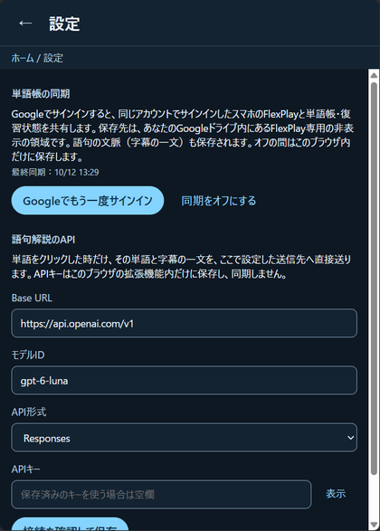
</p>

APIキーは、スマホでは端末内で暗号化して、PCではこのChromeの拡張機能の中だけに保存します。同期はしません。

### 単語帳を同期する（任意）

スマホとPCで、**同じGoogleアカウント**でサインインします。

- **スマホ**：「設定」→「単語帳の同期」→「Googleでサインインして同期」
- **PC**：サイドパネルの「設定」→「単語帳の同期」→「Googleでサインインして同期」（Chromeにログインしているアカウントが使われます）

「最終同期」の日時が出れば完了です。それぞれの端末にあった単語帳はまとめられます。以前に別の版のFlexPlay（開発版など）を使っていた場合も、そちらで同期をオンにしてから新しい版で同じアカウントにサインインすると、同じ単語帳を引き継げます。

## 使い方（スマホ）

### 字幕を出す

1. FlexPlayのホームで動画アプリを選び、「**ライブ字幕を開始**」を押します。
2. 画面の共有を聞かれたら「**画面全体を共有**」を選びます。
3. 準備ができたら動画アプリに戻って再生します。

<p align="center">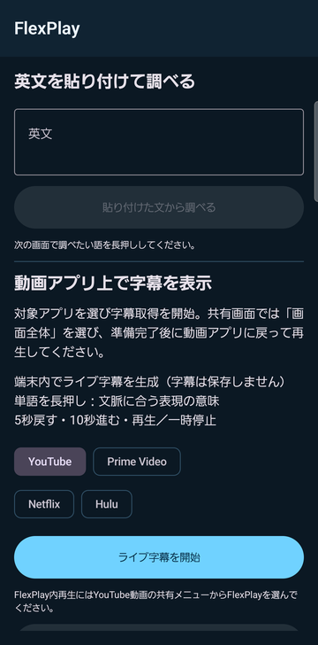</p>

### 字幕の操作

| 操作 | できること |
| --- | --- |
| 単語を**長押し** | その文での語句の意味・例文・ニュアンス。「単語帳に登録」で保存 |
| 文を**タップ** | 文全体の意味と構文 |
| 下のボタン | 5秒戻す・10秒進む・再生／一時停止 |
| 上のつまみを**ドラッグ** | 字幕の位置を動かす |
| 2本指で**つまむ・広げる** | 字幕の高さを変える |
| **×**（またはつまみを長押し→閉じる） | 字幕の表示だけを閉じる。字幕づくりは続き、ホームの「字幕を再表示」で戻せます |
| ホームか通知の「**字幕取得を終了**」 | 字幕づくりそのものを止める |

字幕の背景やボタンの透明度は「設定」で変えられます。

### 他のアプリの英文を調べる

- ブラウザなどで英文を選び、メニューの「**FlexPlayで調べる**」を押す
- 英文を「共有」からFlexPlayへ送る
- FlexPlayのホームの「英文を貼り付けて調べる」に貼り付ける

開いた画面で、調べたい語を長押しします。

<p align="center">
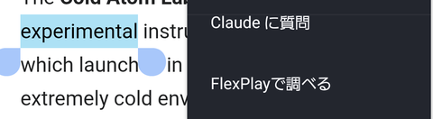<br>
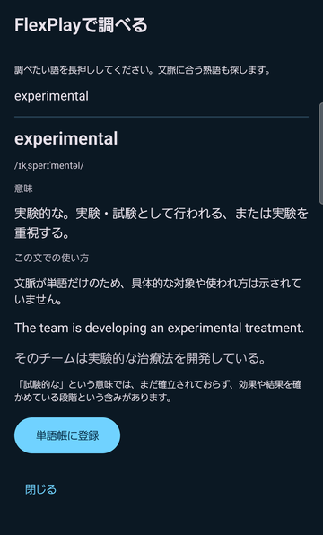
</p>

### 単語帳

解説の「単語帳に登録」で保存した語は、ホームの「**単語帳**」で意味・例文・覚えた時の字幕の一文と一緒に見られます。いらない語は「削除」で消せます（同期していれば、ほかの端末からも消えます）。

### ウィジェット

ホーム画面を長押し →「ウィジェット」→「**FlexPlay 単語**」を選んで置きます。登録した語の表現・発音・意味・例文を表示し、「**次へ**」で次の語に替わります。表示した語は時間をおいて繰り返し出てきます。

<p align="center">
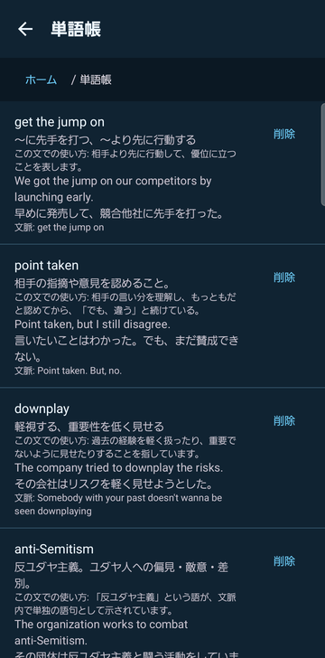
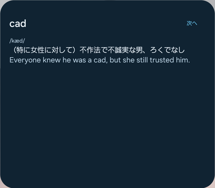
</p>

## 使い方（PC）

### 字幕を出す

YouTube・Netflix・Prime Videoで作品を開くと、自動で英語字幕が動画の上に出ます。字幕の一覧は、YouTubeでは動画の横（横に余白がない時は下）、Netflix・Prime Videoでは字幕の下の「**一覧**」で開きます。一覧の行を押すとその場面へ移動します。

<p align="center">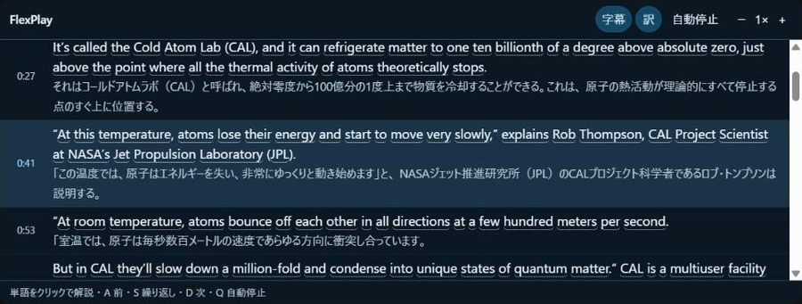</p>

### 字幕の操作

| 操作 | できること |
| --- | --- |
| 単語を**クリック** | その文での語句の意味・例文。「単語帳に登録」で保存 |
| **A**・**S**・**D** | 前の字幕・同じ字幕をもう一度・次の字幕 |
| **Q**（または「自動停止」） | 字幕ごとに自動で一時停止（もう一度押すと解除） |
| **Esc** | 解説を閉じる |
| 「字幕」 | FlexPlayの字幕のオン・オフ |
| 「訳」 | 日本語訳を並べて表示（日本語字幕がある作品のみ） |
| 「−」「＋」 | 再生速度 |

### サイドパネル

ツールバーのFlexPlayを押すと開きます。**復習カード**（「次へ」で次の語）、**単語帳**（「詳しく」で解説、「削除」で消す）、**設定**があります。

## 更新のしかた

- **スマホ**：新しいAPKをダウンロードして開き、そのまま上書きでインストールします。単語帳・設定・APIキーは残ります。
- **PC**：新しいZIPを展開し、**今使っているフォルダの中身を入れ替えて**から、`chrome://extensions` でFlexPlayの再読み込み（↻）を押します。別のフォルダから読み込み直すと、APIキーの入れ直しが必要になることがあります。

何が変わったかは[リリースページ](https://github.com/kaish-yo/flexplay-releases/releases)で確認できます。

## ダウンロードしたファイルの確認

ダウンロードしたファイルと `SHA256SUMS.txt` を同じフォルダに置き、次を実行します。表示された値が `SHA256SUMS.txt` の値と同じなら、配布したファイルと同じものです。

**Windows（PowerShell）**

```powershell
Get-FileHash .\flexplay-*-chrome.zip -Algorithm SHA256
Get-Content .\SHA256SUMS.txt
```

**Mac（ターミナル）**

```sh
shasum -a 256 -c SHA256SUMS.txt --ignore-missing
```

## 困ったとき

| 症状 | 対処 |
| --- | --- |
| PCで字幕が出ない・「ページを再読み込みしてください」と出る | ページを再読み込みしてください。FlexPlayを入れる前から開いていたページや、サイト内で移動しただけのページでは字幕を受け取れないことがあります。作品に英語字幕があるかも確かめてください |
| PCで「この作品には英語字幕がありません」 | その作品には英語字幕がないため使えません |
| スマホで字幕が出ない | 「画面全体を共有」を選んだか、動画アプリの音が出ているかを確かめてください。Netflixは英語字幕をオンにし、ユーザー補助の「FlexPlay 再生・字幕サポート」をオンにしてください |
| 「APIキーが未設定です」「APIキーを入力してください」 | [最初の設定](#apiキーを保存する)でAPIキーを保存してください |
| 「APIキーが拒否されました（401）」 | APIキーの入れ間違いか、無効になったキーです。設定で入れ直してください |
| 「APIの利用権限がありません（403）」 | そのキーで使えないモデルか、APIの側で利用が止められています。APIの管理画面を確かめてください |
| 「API利用上限を確認してから再試行してください」「APIの利用上限に達しています」 | APIの残高や利用上限に達しています。APIの管理画面で確かめ、少し待ってから試してください |
| 「モデルIDまたはAPI形式を確認してください」 | 送信先（Base URL）・API形式・モデルの設定が合っていません。OpenAIを使うなら初期値に戻してください |
| Googleでサインインできない | スマホはGoogleアカウントが端末に追加されているか、PCはChromeにログインしているかを確かめてください |
| 同期が反映されない | 両方の端末が同じGoogleアカウントか確かめ、設定の「最終同期」の日時を見てください。スマホはネットワークにつながった時と一定時間ごとに同期します |

解決しない時は、[Issues](https://github.com/kaish-yo/flexplay-releases/issues)でお知らせください。APIキーやメールアドレスなどの個人情報は書かないでください。

## データとプライバシー

- 開発者は利用者の情報を集めるサーバーを持っていません。
- **字幕・音声・画面**は保存も送信もしません（スマホの字幕は端末内で作ります）。
- **語句を調べた時だけ**、その語句と字幕の一文を、自分で設定したAPIへ直接送ります。
- **単語帳**は端末（PCはChromeの拡張機能の中）に保存します。同期をオンにすると、自分のGoogleドライブの**FlexPlay専用の非表示の領域**にも保存します。ほかのファイルは読みません。

詳しくは[プライバシーポリシー](https://kaish-yo.github.io/flexplay-site/privacy.html)を参照してください。

## アンインストールとデータの削除

- **スマホ**：FlexPlayをアンインストールすると、端末内の単語帳・設定・APIキーは消えます。
- **PC**：`chrome://extensions` でFlexPlayを「削除」すると、Chrome内の単語帳・設定・APIキーは消えます。展開したフォルダは手で消してください。
- **Googleドライブの同期データ**：[Googleドライブ](https://drive.google.com/)の設定（⚙）→「アプリの管理」→ FlexPlay の「オプション」→「**非表示のアプリデータを削除**」で消せます。Googleアカウントの「[サードパーティ製のアプリとサービス](https://myaccount.google.com/connections)」から、FlexPlayのアクセスも取り消せます。
