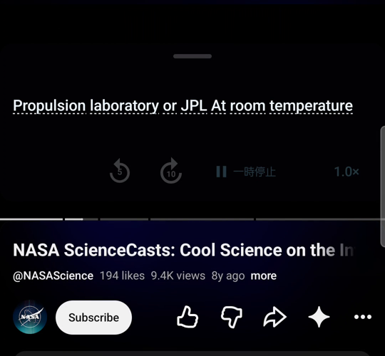
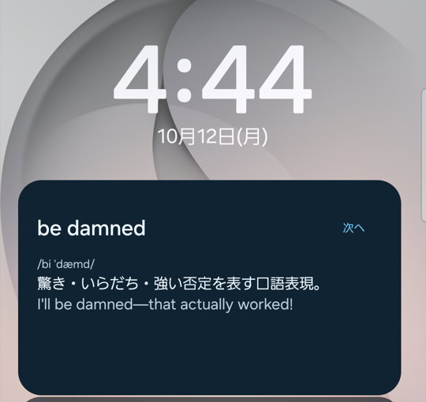
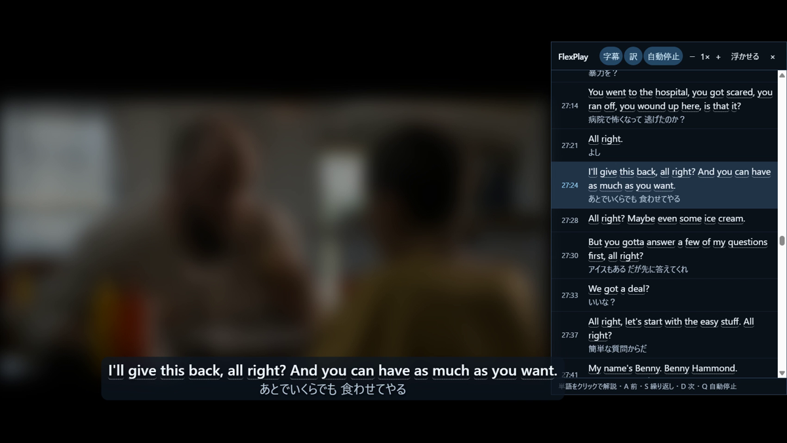
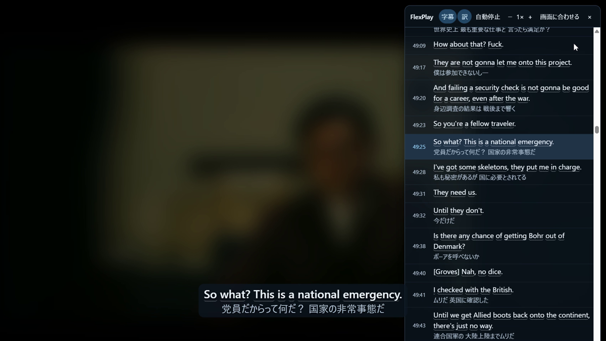
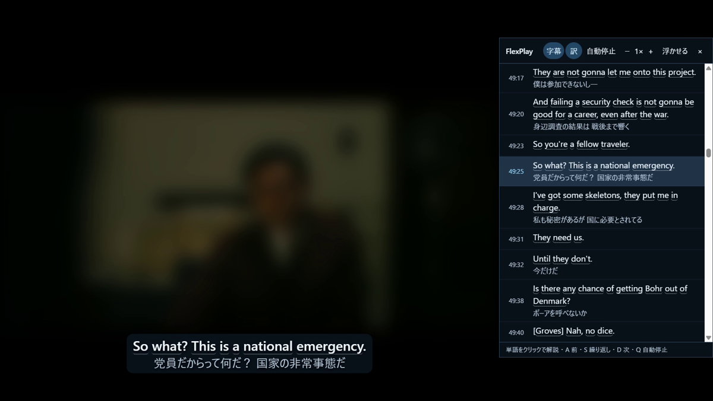
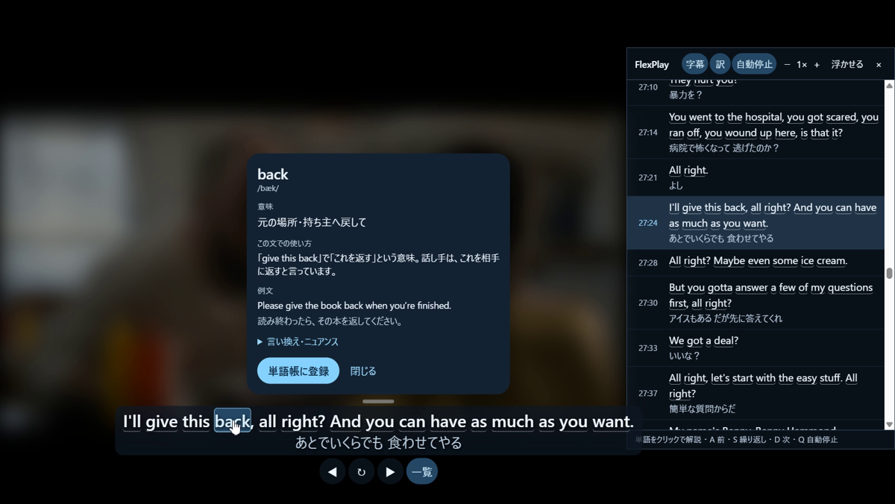

<div align="center">


# FlexPlay

**英語学習に特化した字幕表示および語彙学習のツール**

[**最新版をダウンロード**](https://github.com/kaish-yo/flexplay-releases/releases/latest) ・ [入れ方](#入れ方) ・ [使い方](#使い方スマホ) ・ [困ったとき](#困ったとき) ・ [プライバシーポリシー](https://kaish-yo.github.io/flexplay-site/privacy.html)

</div>

https://github.com/user-attachments/assets/450bdff9-e051-43a4-b99f-bc95db145f7a

FlexPlayはNetflix・Prime Video・YouTubeで洋画やドラマを観ながら英語を学ぶためのAndroidアプリとChrome拡張です。字幕の中で分からなかった単語やフレーズはその場で意味を調べて単語帳に登録できます。登録した語彙は忘れかけた頃にスマホのロック画面とホーム画面に表示されます。

**FlexPlayは動画アプリの上に英語字幕を重ねて表示します。** スマホではNetflix・Prime Video・YouTube・Huluのアプリの上にFlexPlayの英語字幕を表示します。PCではChromeでYouTube・Netflix・Prime Videoを開くと、FlexPlayの英語字幕と日本語訳が動画の上と横の一覧に表示されます。

**FlexPlayは単語の意味をその場面に合わせて説明します。** 字幕の単語を長押しするとFlexPlayがその台詞の文脈に合った意味と使い方と例文を表示します（PCではクリックします）。

**登録した語彙はアプリを開かなくても復習できます。** 単語帳に登録した語彙は30分後・6時間後・1日後・3日後・7日後と間隔を広げながらロック画面とホーム画面のウィジェットに表示されます。Googleでサインインすると、スマホとPCで同じ単語帳を使えます。

## 使えるかどうかの確認

### 対応環境

- **スマホ**：Android 15以上
- **PC**：Chrome 116以上（Windows・Mac）

### 対応サービス

**スマホ**

| アプリ | 字幕の作り方 |
| --- | --- |
| YouTube | 再生中の音声からAndroidに内蔵の音声認識で字幕を作る |
| Prime Video | 再生中の音声からAndroidに内蔵の音声認識で字幕を作る（設定で「画面の英語字幕を読み取る」に切り替えられます） |
| Netflix | 画面に出ている英語字幕をスマホの中で読み取る（Netflixの英語字幕をオンにしてください） |
| Hulu | 再生中の音声からAndroidに内蔵の音声認識で字幕を作る |

FlexPlayはAndroidに内蔵の英語の音声認識を使うので、音声をスマホの外へ送りません。初めて使う時に英語の音声認識データのダウンロードを求められることがあります。認識の精度は音声によって変わるので、作品の正式な字幕と同じにはなりません。動画アプリが音声の取得を禁じている場合は字幕を作れません。

**PC**：YouTube・Netflix・Prime Video（primevideo.comとamazon.co.jpのPrime Video）で使えます。FlexPlayは各サイトが配信している英語字幕を使うので、**英語字幕のない作品では使えません**（YouTubeは自動生成の英語字幕でも使えます）。

### 必要なもの

- **語句の解説に使うAPIキー**（自分で用意します）：[OpenAIのAPIキー](https://platform.openai.com/api-keys)またはOpenAI互換のAPIのキー
- **費用**：語句や文を調べた時だけ、そのAPIの利用料金がかかります。字幕を出すだけなら費用はかかりません。スマホの字幕はAndroidに内蔵の音声認識で作り、PCでは各サイトの字幕を使うからです。
- **単語帳を同期する場合**（任意）：Googleアカウント

## ダウンロード

[**最新版のリリースページ**](https://github.com/kaish-yo/flexplay-releases/releases/latest)の「Assets」から使う方をダウンロードしてください。

| ファイル | 用途 |
| --- | --- |
| `flexplay-<版>-android.apk` | スマホ（Android）用のアプリ |
| `flexplay-<版>-chrome.zip` | PCのChrome用の拡張機能 |
| `SHA256SUMS.txt` | ダウンロードしたファイルが正しいかの確認用（[確認方法](#ダウンロードしたファイルの確認)） |

その版で何が変わったかはリリースページの「変更点」に書いています。

## 入れ方

### スマホ（Android）

1. スマホのブラウザで最新版のページを開き、`flexplay-<版>-android.apk` をダウンロードして開きます。
2. 「この提供元からの不明なアプリをインストールすることはできません」と表示されたら「設定」を押して、**この提供元のアプリを許可**をオンにしてから戻ります。続けて「インストール」を押します（Google Play プロテクトの確認が表示されたら、内容を確かめてから進めてください）。

   

3. FlexPlayを開き、使いたい動画アプリを選んで「ライブ字幕を開始」を押します。必要な許可が順番に表示されるので、許可してください。

| 許可 | 何のために使うか |
| --- | --- |
| 使用状況へのアクセス | 動画アプリが前面にある時だけ字幕を出すため（閲覧の履歴は保存しません） |
| 音声の録音 | 再生中の動画の音声をAndroidに内蔵の音声認識で字幕にするため（マイクの音は使いません） |
| 他のアプリの上に表示 | 動画の上に字幕を出すため |
| 通知へのアクセス（FlexPlay 再生制御） | 字幕から再生・一時停止・巻き戻しを操作するため |
| 通知の送信 | 字幕を作っている間に通知を出すため（通知から字幕を止められます） |
| 画面の共有（「画面全体を共有」を選ぶ） | Androidでは再生中の音声をこの仕組みで受け取るため（画面と音声は保存も送信もしません） |
| ユーザー補助（FlexPlay 再生・字幕サポート） | Prime VideoとNetflixで再生位置を操作するためと、Netflixの字幕を読み取るため（使う場合だけ） |

<p align="center">


</p>

### PC（Chrome）

1. `flexplay-<版>-chrome.zip`をダウンロードして、**決まった場所に展開**します（例：`ドキュメント\FlexPlay`）。Chromeはこのフォルダから拡張機能を読み込み続けるので、**フォルダを消したり動かしたりするとFlexPlayが動かなくなります**。
2. Chromeのアドレス欄に`chrome://extensions`と入力して開き、右上の**デベロッパー モード**をオンにします。
3. **パッケージ化されていない拡張機能を読み込む**を押して、展開したフォルダ（`manifest.json`が入っているフォルダ）を選びます。

   

4. ツールバーのパズルのアイコンを押し、FlexPlayの**ピン**を押してツールバーに固定します。

FlexPlayはChrome ウェブストアを通さずに配布しているので、Chromeが「デベロッパー モードの拡張機能」について注意を表示することがあります。このページから入れたFlexPlayならそのまま使い続けて問題ありません。見覚えのない拡張機能がある時は無効にしてください。

## 最初の設定

### APIキーを保存する

- **スマホ**：FlexPlayの「設定」→「API設定」でAPIキーを入力して、「保存して接続確認」を押します。OpenAIを使う場合は送信先（Base URL）と解説モデルを変える必要はありません。
- **PC**：ツールバーのFlexPlayを押してサイドパネルを開き、「設定」→「語句解説のAPI」でAPIキーを入力して、「接続を確認して保存」を押します。

<p align="center">


</p>

APIキーはスマホでは暗号化してスマホの中に保存し、PCではこのChromeの拡張機能の中だけに保存します。APIキーは同期しません。

### 単語帳を同期する（任意）

スマホとPCの両方で、**同じGoogleアカウント**でサインインします。

- **スマホ**：「設定」→「単語帳の同期」→「Googleでサインインして同期」
- **PC**：サイドパネルの「設定」→「単語帳の同期」→「Googleでサインインして同期」（Chromeにログインしているアカウントが使われます）

「最終同期」の日時が表示されたら完了です。スマホとPCにあった単語帳は1つにまとめられます。以前に別の版のFlexPlay（開発版など）を使っていた場合はその版で同期をオンにしてから新しい版で同じアカウントにサインインすると、単語帳を引き継げます。

## 使い方（スマホ）

### 字幕を出す

1. FlexPlayのホームで動画アプリを選び、「**ライブ字幕を開始**」を押します。
2. 画面の共有について聞かれたら「**画面全体を共有**」を選びます。
3. 準備ができたら動画アプリに戻って動画を再生します。

<p align="center">


</p>

### 字幕の操作

| 操作 | できること |
| --- | --- |
| 単語を**長押し** | その文での語句の意味・例文・ニュアンスを表示します。「単語帳に登録」で保存できます |
| 文を**タップ** | 文全体の意味と構文を表示します |
| 下のボタン | 5秒戻す・10秒進む・再生／一時停止 |
| 上のつまみを**ドラッグ** | 字幕の位置を動かします |
| 2本指で**つまむ・広げる** | 字幕の高さを変えます |
| **×**（またはつまみを長押し→閉じる） | 字幕の表示だけを閉じます。字幕づくりは続いているので、ホームの「字幕を再表示」で元に戻せます |
| ホームか通知の「**字幕取得を終了**」 | 字幕づくりそのものを止めます |

字幕の背景とボタンの透明度は「設定」で変えられます。

<p align="center">


</p>

### 他のアプリの英文を調べる

- ブラウザなどで英文を選び、メニューの「**FlexPlayで調べる**」を押します
- 英文を「共有」からFlexPlayへ送ります
- FlexPlayのホームの「英文を貼り付けて調べる」に英文を貼り付けます

開いた画面で調べたい単語を長押しします。

<p align="center">


</p>

### 単語帳

解説の「単語帳に登録」で保存した語彙はホームの「**単語帳**」で見られます。意味と例文と、調べた時の字幕の一文も一緒に表示されます。いらない語彙は「削除」で消せます（同期している場合はほかの端末からも消えます）。

<p align="center">

</p>

### ウィジェット

ホーム画面を長押しして「ウィジェット」→「**FlexPlay 単語**」を選んで置きます。ロック画面にも置けます（置き方は機種によって違います）。ウィジェットには登録した語彙の表現・発音・意味・例文が表示されます。「**次へ**」を押すと次の語彙に替わります。一度表示した語彙は30分後・6時間後・1日後・3日後・7日後と間隔を広げてもう一度表示されます。

<p align="center">


</p>

## 使い方（PC）

### 字幕を出す

YouTube・Netflix・Prime Videoで作品を開くと、FlexPlayの英語字幕が動画の上に表示され、字幕の一覧が動画の横に表示されます。一覧の行を押すとその場面に移動します。

<p align="center">

</p>

| 一覧の操作 | できること |
| --- | --- |
| 「**画面に合わせる**」（最初の表示） | 一覧を動画の横に並べます。横に空きがない時（全画面など）は動画を縦横比を保ったまま縮めて空いた右側に一覧を並べます |
| 「**浮かせる**」 | 上の帯をドラッグすると一覧を好きな場所に動かせます。右下の角をドラッグすると大きさを変えられます |
| 「**×**」 | 一覧を閉じます。字幕の下の「**一覧**」を押すと開き直せます |

字幕もドラッグして好きな場所に動かせます（動画の外にも置けます）。字幕と一覧の背景の透明度はサイドパネルの「設定」→「字幕の表示」で変えられます。

<p align="center">


</p>

### 字幕の操作

| 操作 | できること |
| --- | --- |
| 単語を**クリック** | その文での語句の意味と例文を表示します。「単語帳に登録」で保存できます |
| **A**・**S**・**D** | 前の字幕へ戻る・同じ字幕をもう一度再生する・次の字幕へ進む |
| **Q**（または「自動停止」） | 字幕ごとに自動で一時停止します（もう一度押すと解除します） |
| **Esc** | 解説を閉じます |
| 「字幕」 | FlexPlayの字幕をオン・オフします |
| 「訳」 | 日本語訳を並べて表示します（日本語字幕がある作品だけ） |
| 「−」「＋」 | 再生速度を変えます |

<p align="center">

</p>

### サイドパネル

ツールバーのFlexPlayを押すとサイドパネルが開きます。サイドパネルには**復習カード**（「次へ」で次の語彙）と**単語帳**（「詳しく」で解説、「削除」で削除）と**設定**があります。

<p align="center">

</p>

## 更新のしかた

- **スマホ**：新しいAPKをダウンロードして開き、今のアプリに上書きでインストールします。単語帳・設定・APIキーはそのまま残ります。
- **PC**：新しいZIPを展開し、**今使っているフォルダの中身と入れ替えて**から、`chrome://extensions`でFlexPlayの再読み込み（↻）を押します。別のフォルダから読み込み直すと、APIキーを入力し直す必要が出ることがあります。

何が変わったかは[リリースページ](https://github.com/kaish-yo/flexplay-releases/releases)で確認できます。

## ダウンロードしたファイルの確認

ダウンロードしたファイルと`SHA256SUMS.txt`を同じフォルダに置いて、次のコマンドを実行します。表示された値が`SHA256SUMS.txt`の値と同じなら、ダウンロードしたファイルは配布したファイルと同じものです。

**Windows（PowerShell）**

```powershell
Get-FileHash .\flexplay-*-chrome.zip -Algorithm SHA256
Get-Content .\SHA256SUMS.txt
```

**Mac（ターミナル）**

```sh
shasum -a 256 -c SHA256SUMS.txt --ignore-missing
```

## 困ったとき

| 症状 | 対処 |
| --- | --- |
| PCで字幕が出ない・「ページを再読み込みしてください」と表示される | ページを再読み込みしてください。FlexPlayを入れる前から開いていたページや、サイトの中で移動しただけのページでは字幕を受け取れないことがあります。作品に英語字幕があるかどうかも確かめてください |
| PCで「この作品には英語字幕がありません」と表示される | その作品には英語字幕がないので、FlexPlayは使えません |
| スマホで字幕が出ない | 画面の共有で「画面全体を共有」を選んだか確かめてください。動画アプリの音が出ているかも確かめてください。Netflixでは英語字幕をオンにして、ユーザー補助の「FlexPlay 再生・字幕サポート」もオンにしてください |
| 「APIキーが未設定です」「APIキーを入力してください」と表示される | [最初の設定](#apiキーを保存する)の手順でAPIキーを保存してください |
| 「APIキーが拒否されました（401）」と表示される | APIキーが間違っているか無効になっています。設定で入力し直してください |
| 「APIの利用権限がありません（403）」と表示される | そのキーでは使えないモデルを指定しているかAPI側で利用が止められています。APIの管理画面を確かめてください |
| 「API利用上限を確認してから再試行してください」「APIの利用上限に達しています」と表示される | APIの残高がないか利用上限に達しています。APIの管理画面で確かめて、少し待ってから試してください |
| 「モデルIDまたはAPI形式を確認してください」と表示される | 送信先（Base URL）・API形式・モデルの設定が合っていません。OpenAIを使う場合は初期値に戻してください |
| Googleでサインインできない | スマホではGoogleアカウントがスマホに追加されているか確かめてください。PCではChromeにログインしているか確かめてください |
| 同期が反映されない | スマホとPCが同じGoogleアカウントでサインインしているか確かめて、設定の「最終同期」の日時を見てください。スマホはネットワークにつながった時と一定時間ごとに同期します |

解決しない時は[Issues](https://github.com/kaish-yo/flexplay-releases/issues)でお知らせください。APIキーやメールアドレスなどの個人情報は書かないでください。

## データとプライバシー

- FlexPlayの開発者は利用者の情報を集めるサーバーを持っていません。
- FlexPlayは**字幕・音声・画面**を保存も送信もしません（スマホの字幕はAndroidに内蔵の音声認識で作ります）。
- FlexPlayが外部へ送るのは**語句を調べた時**のその語句と字幕の一文だけです。送り先は利用者が設定したAPIです。
- **単語帳**はスマホの中（PCではChromeの拡張機能の中）に保存します。同期をオンにすると、自分のGoogleドライブの**FlexPlay専用の非表示の領域**にも保存します。FlexPlayはGoogleドライブのほかのファイルを読みません。

詳しくは[プライバシーポリシー](https://kaish-yo.github.io/flexplay-site/privacy.html)を参照してください。

## アンインストールとデータの削除

- **スマホ**：FlexPlayをアンインストールすると、スマホの中の単語帳・設定・APIキーが消えます。
- **PC**：`chrome://extensions`でFlexPlayを「削除」すると、Chromeの中の単語帳・設定・APIキーが消えます。展開したフォルダは手で削除してください。
- **Googleドライブの同期データ**：[Googleドライブ](https://drive.google.com/)の設定（⚙）→「アプリの管理」→ FlexPlayの「オプション」→「**非表示のアプリデータを削除**」で消せます。FlexPlayへのアクセスの許可はGoogleアカウントの「[サードパーティ製のアプリとサービス](https://myaccount.google.com/connections)」で取り消せます。
